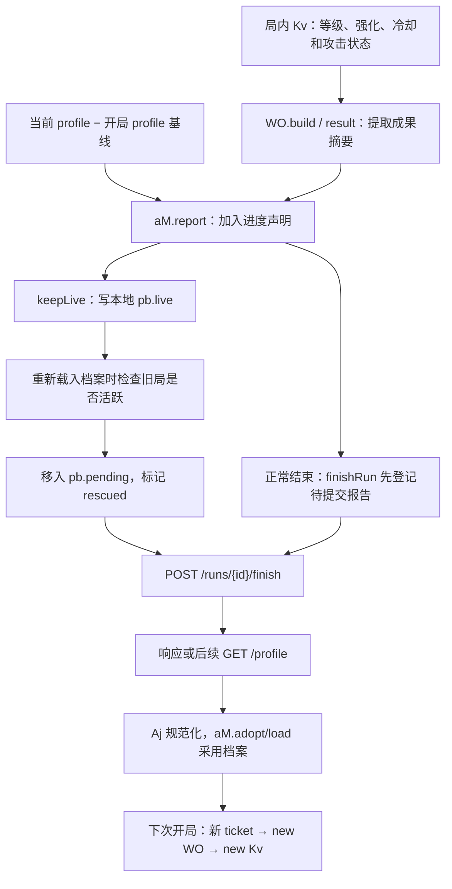

---
aliases:
  - PokéBonk 存档与恢复 0.8.47
tags:
  - 路线/REA辅助研究
  - 项目/PokeBonk
  - 主题/存档恢复
  - 证据/静态分析
updated: 2026-10-25
build: mvnpa0xv
status: 已交付静态研究
---
# PokéBonk 的存档与恢复路径

## 问题、结论和证据边界

本轮回答：招式等级、强化与运行状态进入了哪些保存对象；中断后读取什么、怎样处理；下一局从哪里创建招式；哪些资料属于长期档案，哪些只是历史记录或本地偏好。

**在本构建所查客户端链路中，中断恢复的主要用途是补交本局成果，而不是重建中断时的战场。**`keepLive` 写入一份可供结算的报告；发现旧对局已经不活跃后，客户端把它放进待处理列表并请求该对局的 finish 接口。招式等级和累计伤害会进入配招摘要，逐招强化参数、冷却、蓄力、连射队列等没有进入这份报告。新局通过独立开局请求创建新的玩家与招式实例。[S02](PokéBonk—存档与恢复路径—证据索引—mvnpa0xv.md#S02)、[S05](PokéBonk—存档与恢复路径—证据索引—mvnpa0xv.md#S05)、[S08](PokéBonk—存档与恢复路径—证据索引—mvnpa0xv.md#S08)

这份结论限于 **PokéBonk 0.8.47／构建 mvnpa0xv 的公开客户端静态路径**。2026-10-25 再次从[官网](https://pokebonk.com/)确认构建，并核对[主模块](https://pokebonk.com/assets/main-DasJJ4XQ-mvnpa0xv.js)内容摘要与上轮一致，复用原始捕获。主模块 SHA-256 为 `4E050B55FF580A8B85FB5E6CFFFBDD5A9A168F30192AC80AB359704C353D95F1`。[S00](PokéBonk—存档与恢复路径—证据索引—mvnpa0xv.md#S00)

没有启动目标游戏、读取个人浏览器存储、登录账号或调用目标业务接口。REA 辅助追踪复用既有 Evidence；自动图为部分覆盖，具体字段和连接由源码逐段核对。能确认客户端的发送、读取与分支，**不能据此确认服务器实际接受了哪些成果、怎样计算奖励、保存多久或是否已落盘**。完整位置、工具记录和限制见[证据索引](PokéBonk—存档与恢复路径—证据索引—mvnpa0xv.md)。

## 先区分四种“恢复”

| 场景 | 客户端实际处理 | 招式对象怎样处理 |
| --- | --- | --- |
| 同一页面暂停或升级弹窗结束 | `WO.resume` 把 paused/modal 改回 play，并处理界面与输入 | 继续使用内存中的对象；这里没有反序列化或创建 `Kv` |
| 页面中断后补交成果 | 读 `pb.live`／`pb.pending`，判断旧局是否仍活跃，再提交 finish 请求 | 使用成果报告补结算；所查路径不从报告重建战斗对象 |
| 再次进入账号 | 恢复会话身份，再载入 profile、规范化字段、应用设置和菜单 | 恢复长期档案的客户端对象，没有从历史等级恢复当前招式 |
| 开始下一局 | 请求新 ticket，创建 `WO`、玩家和起始招式，并应用长期加成与本次携带品 | 普通招式经 `Hv` 和 `new Kv` 创建，等级与运行状态从构造默认值开始 |

`ticket` 是开局接口返回的本局编号与配置。`profile` 是长期档案的客户端表示。`aM.snap` 是开局时复制的 profile 基线，用于算进度差值、处理并发更新与提交失败后的档案回退；它没有复制战场或招式实例。不要将这个 snap 当成完整战斗存档。[S03](PokéBonk—存档与恢复路径—证据索引—mvnpa0xv.md#S03)、[S07](PokéBonk—存档与恢复路径—证据索引—mvnpa0xv.md#S07)、[S08](PokéBonk—存档与恢复路径—证据索引—mvnpa0xv.md#S08)

## 保存与补交的主路径

图中的 `rescued` 是中断成果的补交标记，与我们项目讨论的伙伴救援池没有对应的机制关系。箭头表示静态代码连接，未做实际请求和读档验证。

### 什么时候保存

局内模拟以 `MO=30` 安排 keepLive，以导入配置的 `heartbeat=60` 安排 checkpoint；checkpoint 也会调用 keepLive。这两个数沿游戏模拟时间推进，不构成严格的每 30／60 秒墙钟写盘保证。离开页面的 pagehide、文档 freeze、进入隐藏状态等事件也调用 keepLive。部分捕获进度更新后会立即调用它。[S04](PokéBonk—存档与恢复路径—证据索引—mvnpa0xv.md#S04)

checkpoint 请求主要含 `t、stage、kills、level、damage、splits`，没有完整角色或招式对象。后端适配器有内存中的待发 checkpoint 队列；本地 live／pending 报告只附带最后最多 300 条仍在队列中的记录，不能把它当作完整输入录像或可回放日志。[S04](PokéBonk—存档与恢复路径—证据索引—mvnpa0xv.md#S04)、[S05](PokéBonk—存档与恢复路径—证据索引—mvnpa0xv.md#S05)

### 报告怎样进入本地存储

`WO.keepLive` 在尚未结束且尚未标记 sent 时，用 `result(false)` 生成报告，并附上本局捕获、闪光等集合。`aM.report` 再加入相对于开局 profile 基线的正向计数差、研究差、新见过的物种与形态，以及本次捕获集合。[S02](PokéBonk—存档与恢复路径—证据索引—mvnpa0xv.md#S02)、[S03](PokéBonk—存档与恢复路径—证据索引—mvnpa0xv.md#S03)

只有取得有效本局 ID，且存在开局 profile 基线时，才走这条 keepLive 路径。HTTP 适配器最终使用 localStorage 包装器写入：

| 本地键 | 内容与用途 |
| --- | --- |
| `pb.live` | 当前报告：ticket、result、账号 ID、待发 checkpoint；result 的 end.how 被设为 rescued |
| `pb.pending` | 尚待提交的报告列表，代码用 slice(-5) 保留最后最多五条 |
| `pb.liveBeat`／`pb.liveBeat.{id}` | 活跃时间标记，用于辅助判断旧局是否仍由页面持有 |
| `pb.session` | 恢复账号会话所用的身份记录；它不是长期 profile 或战斗快照 |

这是源码中的字段契约，本轮没有读取这些键在任何真实账号下的值。[S05](PokéBonk—存档与恢复路径—证据索引—mvnpa0xv.md#S05)、[S07](PokéBonk—存档与恢复路径—证据索引—mvnpa0xv.md#S07)

### 重开后怎样处理旧局

`AV.loadProfile` 先尝试 flushPending，再请求 `GET /profile`；前一步最多等待一段有限时间，未结束的重试可以继续在后台进行。flushNow 只处理当前账号的记录；当旧 live 既不是当前适配器正在持有的对局、也未被活跃检测认定为仍在使用时，才把它转成 pending 并标记 rescued。[S05](PokéBonk—存档与恢复路径—证据索引—mvnpa0xv.md#S05)、[S07](PokéBonk—存档与恢复路径—证据索引—mvnpa0xv.md#S07)

活跃检测使用浏览器锁与本地时间标记，并非简单地“只要发现 pb.live 就结算”。具体超时条件见索引；本轮未测多标签页或浏览器休眠时的实际表现。

随后客户端发送 `POST /runs/{id}/finish`，携带原 result 和待发 checkpoints。成功后移除 pending，通知界面已有成果保存；客户端对 409 也按已处理分支计数。这里没有读取报告中的招式等级来赋回玩家，也没有把 timer、坐标或敌人列表还原。服务器是否接受和怎样处理重复提交仍需服务端或运行证据。[S05](PokéBonk—存档与恢复路径—证据索引—mvnpa0xv.md#S05)、[S06](PokéBonk—存档与恢复路径—证据索引—mvnpa0xv.md#S06)

## 招式与局内字段到底保存了什么

| 字段或对象 | 运行时来源 | 本轮查到的保存去向 | 对重建意味着什么 |
| --- | --- | --- | --- |
| 招式身份 | `Kv.def.id/key` | result.moves 是名称键列表；build.moves[].k 也存名称键 | 可标识历史招式，但没有保存完整定义 |
| 招式等级 | `Kv.level`，升级时由 `Yv` 增加 | build.moves[].lv | 保存了历史等级，不表示下局沿用此等级 |
| 累计伤害 | `Kv.damageDone` | build.moves[].dmg，做取整与上限处理 | 是统计值，不是招式基础威力或可直接恢复的攻击参数 |
| 逐招强化 | `mods` 的 dmg、cd、count、area、speed、dur、pierce、crit、status、bounce | 所查 build/result/progress 中没有逐招 mods | 同一等级可以对应不同升级选择；不能仅用 lv 精确还原强化 |
| 运行状态 | timer、phase、active、tick、aimX/Z、charging、orbHits、burst、sub、swapT | 所查报告中没有这些字段 | 不能从这份报告续接剩余冷却、蓄力或已发出的攻击 |
| 招式槽位 | 玩家 moves 数组 | 两处摘要均先 filter(Boolean)，没有写原槽位编号 | 空槽位置没有被保留为可重建信息 |
| 全局折算属性 | 玩家 stats | build.stats 保留一组有限、经取整的总属性 | 是整体结果，不能代替每招 mods |
| 道具与维生素 | 玩家 items / vitamins | build.items 保存计数；build.vits 保存名称键与等级 | 可用于展示本局配置，不代表自动带入下一局 |
| 角色等级、形态、生命 | player.level、speciesId、hp | result 有最终等级、最终物种等；end.hp 是归一化比例 | 没有保存完整角色状态与战场 |
| 融合 | 实例与本局融合集合 | result 可带 fusions，build 中有当前招式键 | 本轮只核对保存边界，未审核融合重建或全部特殊实例字段 |

[S01](PokéBonk—存档与恢复路径—证据索引—mvnpa0xv.md#S01)、[S02](PokéBonk—存档与恢复路径—证据索引—mvnpa0xv.md#S02)、[S03](PokéBonk—存档与恢复路径—证据索引—mvnpa0xv.md#S03)

“没有这些字段”的结论只指上表列出的客户端报告对象，不扩成服务器所有表、全部功能或未来版本的全局断言。build 的生成还包在 try/catch 中，异常时 result 可以缺少 build；旧记录也有无 build 的显示回退。[S02](PokéBonk—存档与恢复路径—证据索引—mvnpa0xv.md#S02)、[S12](PokéBonk—存档与恢复路径—证据索引—mvnpa0xv.md#S12)

### 保存了等级，历史界面怎样使用

历史配招界面 `BM` 读取 build.moves 的 k、lv、dmg，用当前资料查名称、属性和描述，显示等级与伤害占比；没有 build 时，从旧 moves 列表生成 lv=0、dmg=0 的展示记录。客户端还提供 `GET /runs/{id}/build` 来读取往期配置。**这条路径重建的是展示内容，所查函数没有创建可继续战斗的玩家。**[S12](PokéBonk—存档与恢复路径—证据索引—mvnpa0xv.md#S12)

另一个容易混淆的入口是 `Wk`：它确实创建临时 Kv、复制等级与 mods，再假设做一次升级，用于比较升级前后的属性。这是界面预览中的内存复制，不是从 localStorage 或服务器读档恢复。[S12](PokéBonk—存档与恢复路径—证据索引—mvnpa0xv.md#S12)

## 下一局从哪里重建

1. `VV.openRun` 发起新局，请求所选 species、biome、tier、boosts、mode 等；接收新的 ticket.seed 和 ticket.boosts。
2. 创建 `new WO`，选择模式、地图与角色，并读取当前 profile 设置、实验室等级等。
3. 首次 `buildStage(true)` 创建新的玩家、敌人、投射物与结算对象。玩家普通等级初值为 1；长期加成传给玩家构造，起始生命由重新计算的 maxHp 设置。
4. 从角色起始配置或起始选择取得招式 ID，调用 `Gy.addMove → Hv → new Kv`。普通实例初值为 level=1、timer=0.4，mods 取默认值，active/tick 为 0、charging 为 false、burst 为空。
5. 应用本次开局消耗品。部分道具会调整初始等级、待升级次数等，因此不能把“构造初值为 1”概括为所有开局最终都只有 1 级。

这条新局链不从上一份 build.moves[].lv 或逐招 mods 载入成长。页面内的 pause/resume 则使用已有实例；两者的对象生命周期不同。[S01](PokéBonk—存档与恢复路径—证据索引—mvnpa0xv.md#S01)、[S08](PokéBonk—存档与恢复路径—证据索引—mvnpa0xv.md#S08)

## 哪些内容按客户端契约跨局保留

下面区分“客户端把它当作长期资料使用”与“已经验证服务器永久保存”。本轮只确认前者及相应请求路径。

| 类别 | 客户端字段/入口 | 下局或局外用途 |
| --- | --- | --- |
| 货币与长期资源 | stardust、bonk、totalStardust、totalBonk、bag | 实验室、商店和开局消耗品等；最终奖励、余额以响应档案为准 |
| 可选角色与收藏 | starter、unlocked、league、captured、seen、forms、shinies、classics | 角色资格、图鉴与收藏相关内容；部分收藏还影响实验室加成计算 |
| 长期升级与地图进度 | lab、biomes、research、counters、quests 等 | 实验室属性、槽位和功能，以及区域开放和任务进度 |
| 纪录与外观 | runs、best、times、kills、medals、endless、skins、cosmetics 等 | 历史、成绩和外观；某局的配招等级记录属于历史信息 |
| 设置与选择偏好 | settings、lastSpecies、lastBiome、team 等 | 使用偏好与可选成员列表；所查开局请求没有直接提交 team，不能把它等同于自动参战队伍 |
| 本地配装计划 | `pokebonk.buildPlan.{账号ID或local}` | 保存希望获得的招式、维生素、融合、道具列表，局内显示是否达成；不是已经拥有的实例和等级 |

长期 profile 经 `GET /profile → Aj → aM.load/adopt` 读取。Aj 合并默认结构、补齐部分类型与缺省字段，并保留响应对象中的其他字段；它不是本轮已经验证完备的存档迁移系统。偏好通过 prefs 接口发送，实验室等通过动作接口发送，结束成果通过 finish 接口发送；客户端 `save()` 不能被理解为把整个 profile 原样写入本地。[S07](PokéBonk—存档与恢复路径—证据索引—mvnpa0xv.md#S07)、[S09](PokéBonk—存档与恢复路径—证据索引—mvnpa0xv.md#S09)、[S10](PokéBonk—存档与恢复路径—证据索引—mvnpa0xv.md#S10)、[S11](PokéBonk—存档与恢复路径—证据索引—mvnpa0xv.md#S11)

开局时，客户端按 ticket.boosts 扣减本地 bag 数量，再将返回的消耗品应用于新局。长期实验室与收藏加成会重新折算进基础属性；这与保存、继承上局招式 mods 是不同的作用方式。[S08](PokéBonk—存档与恢复路径—证据索引—mvnpa0xv.md#S08)、[S10](PokéBonk—存档与恢复路径—证据索引—mvnpa0xv.md#S10)

## 恢复边界与失败情形

| 情况 | 静态路径能确认什么 | 未验证部分 |
| --- | --- | --- |
| 没有有效服务器开局 ID | keepLive 不写有效 live；finishRun 抛出离线局未保存进度的错误 | 未实测断网与重新联网 |
| 中断发生在两次记录之间 | 只能补交已写入的报告与待发检查点 | 最坏损失窗口与事件触发可靠性未测，不能承诺零丢失 |
| localStorage 写入失败 | vV.set 捕获异常且不向外抛出 | 是否遇到配额/权限失败、界面如何告知未测；报告存在内存中不等于已持久化 |
| 多个待补交对局 | pending 列表保留最后最多五条 | 超出容量后的实际用户体验未测，不能称无限保留 |
| 可重试提交错误 | 客户端保留记录并安排退避重试；具体分类见 EV | 服务器最终是否接受、会否重复计奖未知 |
| 非重试错误 | 部分状态码走移除 pending 分支；409 特别按已处理计数 | 不能据客户端 409 分支证明服务器的幂等与奖励规则 |
| 更新后读取旧记录 | profile 有缺省修补，历史 build 缺失时可回退展示 | 完整版本兼容、旧名称键失效、跨构建恢复未验证 |
| 真正从中断点续玩 | 所查 live/pending、profile、历史展示、新局创建链不实现完整战场反序列化 | 不能外推为所有平台、功能和未来构建都不存在该能力 |

[S05](PokéBonk—存档与恢复路径—证据索引—mvnpa0xv.md#S05)、[S06](PokéBonk—存档与恢复路径—证据索引—mvnpa0xv.md#S06)、[S09](PokéBonk—存档与恢复路径—证据索引—mvnpa0xv.md#S09)、[S12](PokéBonk—存档与恢复路径—证据索引—mvnpa0xv.md#S12)

## 供游戏路线参考的取舍

这些是由外部实现推导的建议，由游戏路线审核采用，不修改当前游戏规则。

- **分别定义长期档案、可继续的一局、成果与历史记录。**PokéBonk 的成果补交可供“中断后保住已取得进度”参考；如果我们需要重开后继续原迷宫，还要设计完整的单局保存结构。
- **需要恢复逐招强化时，单存等级不够。**可比较保存 mods 最终值，或保存版本化的升级选择记录并重算。前者读取直接，但升级公式改变时需要迁移；后者能解释来源，但依赖旧规则和选择记录仍可重放。
- **明确恢复瞬间的动作规则。**保存剩余冷却、蓄力和投射物能接近中断现场，保存范围较大；只在行动边界保存，并声明瞬时表现如何清理，会缩小需要重建的状态。两种方案都需由我们的行动推进回合规则决定。
- **把历史展示与永久培养分开。**记录某局招式达到 8 级，不应自动变成伙伴永久拥有 8 级招式；同样，配装愿望清单也不等于背包或已学招式库。
- **将本地记录成功、待提交、服务器确认分别表达。**PokéBonk 的 pending 与补交机制提供了一个可参考的流程，但实际存储失败、容量和服务端校验仍有边界，不能直接当作完整可靠性保证。

本轮已回答字段去向、补交路径与新局创建的静态问题。没有验证真实读档、服务端持久化、跨设备同步、崩溃恢复或全模式行为；游戏路线可以先依据已确认的结构作方案比较。

关联：[REA 结果目录](README.md)、[普通招式执行路径](PokéBonk—普通招式执行路径—mvnpa0xv.md)、[REA 路线职责](../../90-archive/早期框架/REA辅助研究路线.md)、[游戏路线](../../90-archive/早期框架/游戏项目路线.md)。
