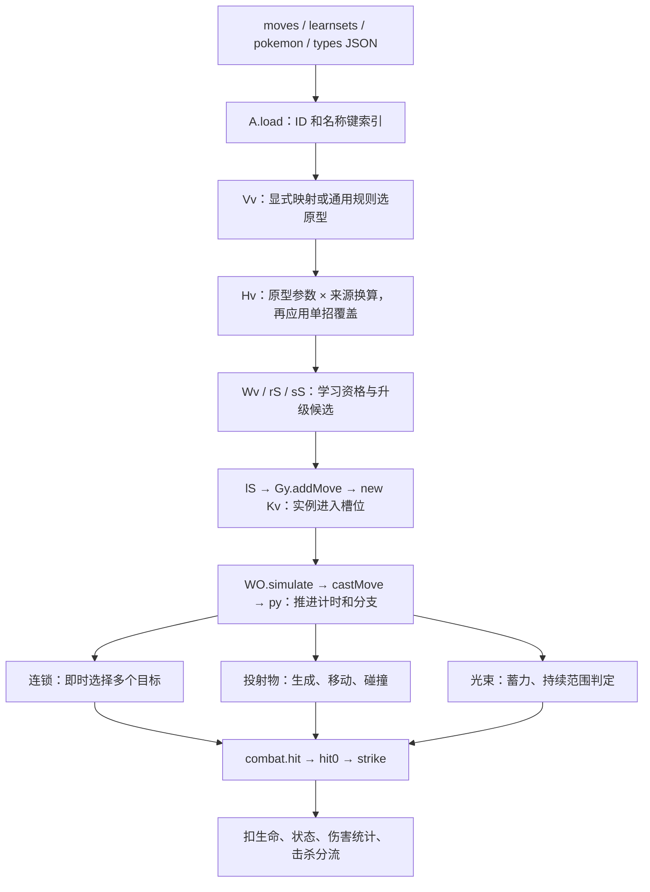

---
aliases:
  - PokéBonk 普通招式执行路径 0.8.47
tags:
  - 路线/REA辅助研究
  - 项目/PokeBonk
  - 主题/招式执行
  - 证据/静态分析
updated: 2026-10-25
build: mvnpa0xv
status: 已交付静态研究
---
# PokéBonk 普通招式：从数据到执行

## 研究问题与结论

问题：一条普通招式怎样从公开资料变成可学习的局内实例，再找到目标、产生攻击、结算伤害与状态？哪些结构可供二维迷宫参考？

**已追通本构建中普通招式的静态主路径，并逐段核对十万伏特、飞叶快刀和日光束三个分支。**共同流程是：资料载入 → 选择攻击原型 → 换算定义与单招覆盖 → 学习候选筛选 → 创建带运行状态的实例 → 每帧推进 → 按原型选择目标与攻击方式 → 统一伤害/状态/击杀结算。三个样例不是三份独立战斗系统，也不是把原始资料原样执行。

本轮没有启动目标游戏，**没有实机命中、伤害、遮挡或平衡验证**。REA 自动语义图有截断，完整路径来自 REA 产物定位与逐段源码核对的结合，不是工具已经自动证明了全游戏调用链。来源、范围与机器可读索引见[证据索引](PokéBonk—普通招式执行路径—证据索引—mvnpa0xv.md)。

## 目标身份与分析范围

- 官网捕获时的版本标签为 **0.8.47**，HTML 与更新模块的构建标识均为 **mvnpa0xv**。入口是 [main-D1tqSJkl-mvnpa0xv.js](https://pokebonk.com/assets/main-D1tqSJkl-mvnpa0xv.js)，它动态导入 [main-DasJJ4XQ-mvnpa0xv.js](https://pokebonk.com/assets/main-DasJJ4XQ-mvnpa0xv.js)。旧笔记的构建及压缩名不作为本轮位置依据。[E01](PokéBonk—普通招式执行路径—证据索引—mvnpa0xv.md#E01)
- 主模块 SHA-256：`4E050B55FF580A8B85FB5E6CFFFBDD5A9A168F30192AC80AB359704C353D95F1`。本地保留原始响应、每文件 URL/时间/摘要、REA 完整证据、显示用格式化文本和范围映射。
- 工具为 REA 6.7.0，源码提交 `475f09d5ca4f854cbc634074d5534717d58c6664`，Node.js 24.22.1。实际使用现有 CLI；未改 REA 源码、依赖、客户端注册或分析引擎。
- 范围是**单人模式下玩家角色的普通招式主链**；融合、终极技、联机权威结算、完整存档和全招式覆盖不在本次完成范围内。源码出现这些分支时标出边界，没有将其等同于普通路径。

## 数据如何变为运行中的招式



图表示本构建中的静态连接，不表示这些路径已实际运行。

| 阶段 | 本构建的可定位实现 | 已确认的做法 |
| --- | --- | --- |
| 载入与索引 | `na`、`A.load`；news 中 `ma` 导出为主模块的 `an` | URL 带每份数据的版本标签；招式按数值 ID 和稳定名称键分别索引，学习表单独保存。语言覆盖修改显示名称，名称键仍用于映射。[E02](PokéBonk—普通招式执行路径—证据索引—mvnpa0xv.md#E02) |
| 原型选择 | `Vv`、`Pv`、`Iv`、`Lv` | 显式招式映射优先。未显式映射者再按类别、吸取、多段、名称模式、命中字段和属性选原型；部分状态招式无法适配时返回空值。[E03](PokéBonk—普通招式执行路径—证据索引—mvnpa0xv.md#E03) |
| 定义换算 | `Hv`、`Av`、`Fv`、`pv`、`dv` | 威力影响原型伤害与冷却；复制类型/分类，转换状态，添加默认状态与暴击字段，最后做逐招覆盖并缓存。定义与来源记录是不同对象。[E03](PokéBonk—普通招式执行路径—证据索引—mvnpa0xv.md#E03) |
| 学习资格 | `Wv`、`rS`、`sS` | 汇总当前物种与进化前身，去重并检查能否适配；再检查等级、空槽、已拥有、放逐和角色配置。角色自带招式、普通学习表、已解锁角色的共享来源是不同候选入口。[E04](PokéBonk—普通招式执行路径—证据索引—mvnpa0xv.md#E04) |
| 实例创建 | `lS` → `Gy.addMove` → `Kv` | 选择学习后放进可用空槽。实例保存定义引用、等级、计时、强化、持续时间、瞄准、蓄力、连射队列等；初始等级 1、timer 0.4。[E05](PokéBonk—普通招式执行路径—证据索引—mvnpa0xv.md#E05) |
| 升级与折算 | `Jv`、`Yv`、`py` | 原型声明允许升级的字段；升级写实例 mods。执行时再组合定义、招式等级、实例修正及角色属性。基础数据里的 dmg/cd 不是最终伤害和实际施放周期。[E05](PokéBonk—普通招式执行路径—证据索引—mvnpa0xv.md#E05) |
| 调度与攻击 | `WO.simulate` → `WO.castMove` → `py` | 正常模拟中逐槽推进；普通分支按原型处理计时、持续、目标及生成。random 和 fusion 在前面转到另一路径。[E06](PokéBonk—普通招式执行路径—证据索引—mvnpa0xv.md#E06) |
| 命中与结束 | `hh.step` 或原型直接调用 → `mv.hit/hit0/strike` | 目标有效性、伤害倍率、护盾、扣生命、状态、统计和击杀集中处理；不同攻击分支仍各自负责空间命中。[E10](PokéBonk—普通招式执行路径—证据索引—mvnpa0xv.md#E10) |

对于本轮三招使用的通用 `Hv` 分支，伤害和冷却换算可写成下面的转录公式。`clamp(x, a, b)` 表示把 x 限制在 a 到 b 之间；它们是适配公式，不是最终伤害公式。

```text
P = 来源威力；缺失时取 70
定义 dmg = 原型 dmg × clamp(0.72 + P / 260, 0.85, 1.30)
定义 cd  = 原型 cd × clamp(0.88 + (P − 60) / 500, 0.85, 1.15)
           ×（来源优先度 > 0 时取 0.85，否则取 1）
```

原始 PP、目标描述和说明文字没有复制进这条 `Hv` 返回定义；原始命中字段在 `Vv` 中参与原型选择，但本轮三招的空间命中由各自执行分支处理。这个边界说明数据库要经过玩法适配，不能仅凭有某个来源字段就断言游戏按原作执行它。[E03](PokéBonk—普通招式执行路径—证据索引—mvnpa0xv.md#E03)

普通学习表的等级门槛不是原始等级原样沿用：显示门槛为 `max(1, ceil((来源等级−10)/2.6))`，候选筛选按来源等级不高于 `玩家等级×2.6+10` 判断。以皮卡丘的十万伏特来源等级 36 为例，对应本作门槛 10；妙蛙种子的飞叶 12、日光束 36，对应 1、10。这仅是该学习表分支的资格，不保证玩家在该等级必定看到或获得招式；角色自带配置和其他来源另有条件。[E04](PokéBonk—普通招式执行路径—证据索引—mvnpa0xv.md#E04)

## 三个招式的具体路径

以下数字由数据和 `Hv` 公式做离线算术核对，没有执行下载的目标代码。都是**适配后定义值**，尚未叠加角色、升级、天气、道具、暴击、敌人和每次攻击段数。

| 项目 | 十万伏特 `thunderbolt` | 飞叶快刀 `razor-leaf` | 日光束 `solar-beam` |
| --- | --- | --- | --- |
| 来源 ID / 类别 / 威力 | 85 / 电系特殊 / 90 | 75 / 草系物理 / 55 | 76 / 草系特殊 / 120 |
| 显式攻击原型 | chain | barrage | beam |
| 原型伤害 → 适配伤害 | 13 → 13.86 | 5 → 约 4.658 | 7 → 约 8.271 |
| 原型冷却 → 定义 cd | 1.4 → 1.316 | 1.15 → 1.0005 | 2.2 → 2.2 |
| 状态适配 | 来源麻痹 10% → 定义 16% | 来源无状态 → 草系默认 root 12% | 来源无状态 → 草系默认 root 12% |
| 关键区别 | 寻找并串联不同目标 | 分批生成投射物，之后才碰撞 | 蓄力后进行多次光束范围检查 |

`root` 是本作的减速状态：所查正常敌人更新把移动速度乘以 0.35，具体施加仍受状态条件影响。[E10](PokéBonk—普通招式执行路径—证据索引—mvnpa0xv.md#E10)

表格依据与计算记录：[E03](PokéBonk—普通招式执行路径—证据索引—mvnpa0xv.md#E03)、[三招数据与算术结果](../../../../Pokemon_REA_Workbench/pokebonk/2026-10-25-mvnpa0xv-moves/derived/move-examples.json)。三个招式有显式原型映射；本轮检查的 `Fv` 及合并 SPECIAL 表中没有它们的逐招参数覆盖条目。

### 十万伏特：连锁选择后直接结算

`py` 的 chain 分支先用 `aimTarget(14)` 找首个目标。没有目标时将计时设为 0.2 后返回。随后用集合记录已选目标，从当前命中位置附近寻找下一个尚未选过的最近目标；每一跳直接调用 `combat.hit`，基础传入伤害乘 `0.9^跳数`。

循环上限是折算数量 `f + 1`，所以在 count=3 且无额外数量修正时，上限为四个不同目标，实际数量受周围目标限制。专属 link 回调绘制闪电，命中计算仍位于共同分支。基础麻痹字段进入 `strike` 的概率判断，再由 `applyStatus` 写状态；本构建麻痹状态在敌人更新中降低移动速度、概率触发短暂停顿，并随时间衰减。不能把表中 16% 当作包含全部角色增益后的最终概率。[E07](PokéBonk—普通招式执行路径—证据索引—mvnpa0xv.md#E07)、[E10](PokéBonk—普通招式执行路径—证据索引—mvnpa0xv.md#E10)

### 飞叶快刀：创建连射队列，投射物碰撞后结算

barrage 分支在施放时把折算数量放入实例 `burst`。后续更新按 `tick` 发出一枚投射物，代码中一次发射后设间隔 0.06；瞄准中加入随机角度。`projectiles.fire` 只登记位置、速度、生命期、碰撞半径、类型、状态、槽位等，并不在创建时扣敌人生命。

`hh.step` 更新位置，处理寿命、地形、场景物体和边界，再取附近敌人做高度与重复命中检查，成功后进入 `combat.hit`，最后处理弹跳、贯穿或移除。0.06 是调度字段，不是已经实测的精确射速；帧推进和预算也会影响结果。[E08](PokéBonk—普通招式执行路径—证据索引—mvnpa0xv.md#E08)

**有一处需要保留的字段传递差异：**来源 crit=1 使 `Hv` 写入 `critBonus=0.15`，`py` 也计算了该值；但所查 barrage 的 `fire` 参数、`hh` 的存储字段及其碰撞命中参数没有继续携带它。共同伤害层读取的 `n.critBonus` 在这条参数路径上因此没有来源值。不能仅凭定义存在 0.15，就宣称飞叶实际获得了这份额外暴击率。角色全局暴击、特性等仍可生效；本轮没有实测总暴击率，也没有把这项观察认定为已复现的游戏缺陷。[E08](PokéBonk—普通招式执行路径—证据索引—mvnpa0xv.md#E08)、[E10](PokéBonk—普通招式执行路径—证据索引—mvnpa0xv.md#E10)

### 日光束：威力阈值触发蓄力，再持续检查光束区域

beam 分支先取得瞄准方向并建立束线角度。来源威力达到 110 的光束会进入延迟释放分支；日光束的 120 满足条件：登记 0.5 的延迟回调，回调把 active 设为折算持续时间的 1.3 倍。源码里“下一回合发射”的资料描述没有被解释执行；蓄力由游戏自己的条件和计时实现。

active 大于零时，分支以纵向投影、到束线的侧向距离和敌人半径筛选目标，每次 tick 到期直接进入 `combat.hit`，代码重设 tick 为 0.09。视觉 beam 回调负责显示。实际持续命中次数、暂停/切换时序及伤害还需要运行观察，不能直接用持续时间除以 0.09 就当作已验证总次数。[E09](PokéBonk—普通招式执行路径—证据索引—mvnpa0xv.md#E09)

## 共用结算做了什么，以及哪些规则没有统一

共同入口 `mv.hit` 有递归深度与联机模式条件，经过 `hit0` 到 `strike`。在本轮单人范围内可以沿源码确认：

1. 检查目标仍存活、未停放以及 Boss 免疫。
2. 将传入基础伤害乘角色总伤害、物理/特殊、同属性、属性相性、天气、道具/特性和暴击等修正。
3. 处理状态反应、护盾和伤害限制，调用 `takeHp`；记录实际伤害、所属招式槽与累计伤害。
4. 应用击退、概率状态、命中后触发及吸取；生命不大于零时进入 `killEnemy`。普通死亡、捕获对象、Boss 拦截和联机对象仍有分支，不能统一写成“扣到零立即删敌人”。[E10](PokéBonk—普通招式执行路径—证据索引—mvnpa0xv.md#E10)

这里的属性相性也经过玩法改编：`A.effectiveness` 将来源倍率转换为本作倍率并限制总范围，来源的 0 会转为 0.5，而非直接免疫。来源数据库提供信息，执行规则由适配层与结算层决定。[E02](PokéBonk—普通招式执行路径—证据索引—mvnpa0xv.md#E02)

**目标与遮挡没有被一个统一规则包办。**`aimTarget` 先返回仍存活、距离小于传入范围 1.6 倍的锁定目标，这一步不检查视线。没有有效锁定目标时，manual 模式按镜头方向筛选，也不调用 `lineClear`。auto 模式先选范围内的治疗/护盾敌人，该优先分支同样不检查视线；未选到这类目标时，才对普通候选优先取视线可达者，并在没有可达者时退回最近目标。连锁后续跳转按距离选择，所查循环没有再次调用视线检测；光束按投影范围检查，所查分支没有地形截断；投射物另有实际地形与物体碰撞。因此不能把“有 lineClear”概括为所有招式都不会穿墙。这里是所查分支的静态边界，不是全地图遮挡测试结论。[E07](PokéBonk—普通招式执行路径—证据索引—mvnpa0xv.md#E07)、[E08](PokéBonk—普通招式执行路径—证据索引—mvnpa0xv.md#E08)、[E09](PokéBonk—普通招式执行路径—证据索引—mvnpa0xv.md#E09)、[E11](PokéBonk—普通招式执行路径—证据索引—mvnpa0xv.md#E11)

专属视觉与音频通过招式键进入回调表，缺省时使用共用表现。所查三招的专属回调负责叶片、闪电、光束和音效，命中仍按上述路线；不能由这三例推断全部特殊回调都是纯视觉或全部表现都只靠参数。[E12](PokéBonk—普通招式执行路径—证据索引—mvnpa0xv.md#E12)

## 供二维迷宫路线参考的做法与取舍

以下是基于实现的分析建议，**由游戏路线决定采用、改编或不采用**，不改写现有游戏框架。

| 可参考做法 | 能带来的价值 | 本作仍需自己决定 |
| --- | --- | --- |
| 来源资料、适配定义、局内实例分开 | 更新数据库时能辨认来源变化与玩法改编；多只伙伴不会共享同一份冷却/强化状态 | Showdown 的固定版本、物种范围、地牢字段与保存归属 |
| 先选共用行为，再做单招覆盖 | 普通内容可以填参数，独特内容再增加专门行为 | 格子射程、目标阵营、友伤、墙体遮挡、行动成本；不能直接移植本作计时与空间参数 |
| 学习资格与战斗执行分开 | “资料存在”“能适配”“本角色能学”“本局已取得”不混为一谈 | 初始配招、学习来源与基地培养规则 |
| 各种攻击进入共同结算 | 类型、状态、统计和击杀规则集中维护 | 本作的伤害/属性规则，以及各执行分支必须传递哪些字段 |
| 升级能力由行为模板声明 | 不给不支持数量、范围等字段的行为生成无意义升级 | 第一阶段是否有这类升级；不自动加入新系统 |
| 专属表现挂在共用攻击节点上 | 角色与招式能保留辨识度，避免每招重写完整攻击 | 2D 动作、范围提示与素材来源；表现制作仍有单独成本 |

字段传递与遮挡应作为将来实现时的代表性检查点：同一类招式的 crit/status/drain 等字段是否传到命中层；连锁、投射物和光束是否遵守各自声明的墙体规则。这里提出的是观察到的具体风险，不要求现在建设全量测试或插件框架。

## 未验证部分与交付状态

| 项目 | 本轮状态 | 继续验证需要什么 |
| --- | --- | --- |
| 三条静态主链 | 已逐段追到生命/状态/击杀入口，附原始范围与格式化行号 | 新构建需重新核对身份，不能复用压缩名当长期接口 |
| 自动语义图完整性 | 部分；节点/未知记录达到每文件上限，Hv 调用者查询只返回种子和零条关系 | 不可据此说 Hv 无调用者；若以后必须自动追踪，可对有来源映射的较小输入做限定分析 |
| 三招运行结果 | 未执行目标、未观察实机 | 固定构建和角色/道具条件下，记录施放、目标、碰撞、状态与伤害 |
| 飞叶暴击字段差异 | 已确认所查参数链不传该字段；总暴击表现未验证 | 比较控制条件下的实际命中事件及全局修正 |
| 所有普通招式 | 没有穷尽审核；919 条资料不是 919 个可用招式 | 单独定义覆盖集合，再逐类检查，不能以三例外推 |
| 学习候选出现频率 | 已读资格与分支，未测最终抽取频率 | 固定角色配置和进度，观察实际选项生成 |
| 联机、融合、大招、存档 | 本次未完成这些路线 | 仅在出现独立问题后另立研究输入 |
| 开发产能与内部工具 | 仍未知 | 公开客户端只能支持结构分析，不能推算作者工时或证明内部自动化方式 |

本次交付为本报告、证据索引和独立工作目录中的可定位材料。游戏路线可先按结构参考继续设计，不需要等待上述所有未知解决。

关联：[REA 结果目录](README.md)、[REA 路线职责](../../90-archive/早期框架/REA辅助研究路线.md)、[既有招式研究](../参考项目/pokebonk/招式适配与融合系统.md)、[游戏路线](../../90-archive/早期框架/游戏项目路线.md)。
