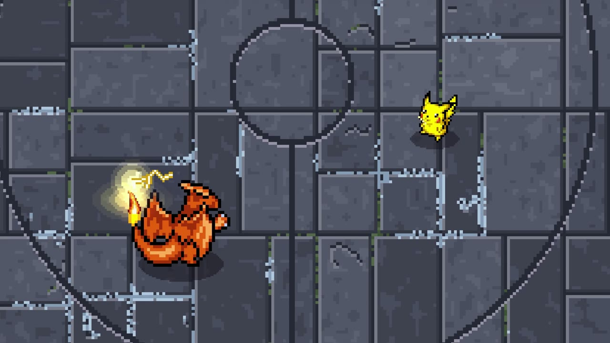
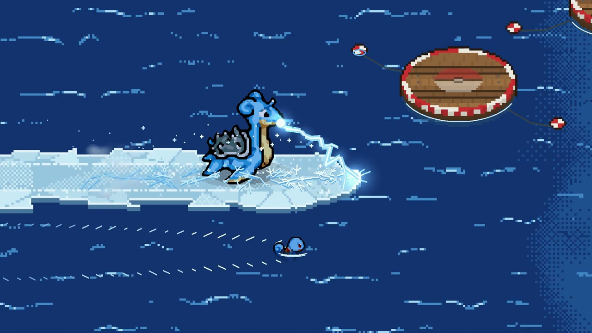

---
aliases:
  - Pokémon Arena 2D 视觉样式参考与素材规格
tags:
  - 项目/PokemonArena2D
  - 主题/美术
updated: 2026-10-25
---
# Pokémon Arena 2D 视觉样式参考与素材规格

用户已表示喜欢 Big Kid Nation 的角色视觉样式，可以作为本项目参考。以下基于 2026 年 10 月 25 日查看的官方截图；候选规格尚未成为最终美术标准。

## 可观察的视觉构成

[截图来源](https://www.bigkidnation.com/img/shot-charizard.jpg)。角色保留清楚的像素块、较深轮廓和明暗色块；脚底阴影把角色与地面联系起来。地面颜色相对收敛，使角色与小范围发光效果容易辨认。截图不能证明使用了何种采样或阴影算法。

[截图来源](https://www.bigkidnation.com/img/shot-ice.jpg)。可见水纹、冰路、平台和独立发光攻击效果。角色身体动画、地形变化与招式特效共同形成观感；只取得角色图像不足以复现整体风格。

官网署名角色头像和动画来自[SpriteCollab](https://github.com/PMDCollab/SpriteCollab)。这里的“模型样式”可以具体拆成多方向像素角色、接地阴影、可读的场地层次，以及独立制作的招式演出。内部引擎和着色实现尚未公开核实。

## 候选素材规格

| 方向 | 后续需要确认的事项 |
| --- | --- |
| 角色 | 物种与形态、所需方向、轮廓、动作覆盖、各动作的脚底基准点 |
| 场景 | 地面与墙体的明暗、可行走边界、遮挡关系和角色与格子的比例 |
| 特效 | 攻击范围可读性、敌我区别、起手和命中的时机、同时出现时的遮挡 |
| 显示 | 角色缩放与像素清晰度、镜头距离、目标选择提示 |
| 来源 | 作者、原始文件、版本、许可、修改记录与署名 |

优先用一组角色和同一场景检查比例、方向与效果的协调，再确定批量素材要求。具体像素尺寸、颜色数量、视角和放大方式尚未决定。

两张截图用于研究参考，不作为可直接投入游戏的资源包。实际素材流程见[[05-制作流程/角色素材与招式特效流程]]；公开展示与游戏机制的区别见[[06-研究/参考项目/pokemon-arena-2d/战斗场地与美术资源]]。