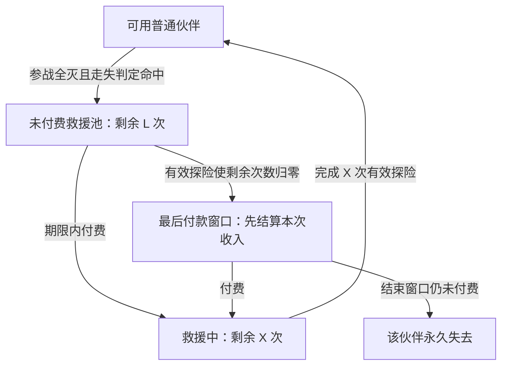

---
aliases:
  - 伙伴招募与救援框架
tags:
  - 玩法/伙伴
  - 玩法/救援
  - 阶段/初期框架
updated: 2026-10-28
---
# 伙伴招募与委托救援框架

当前规则以[核心玩法与首版范围](核心玩法与首版范围.md)为准。本页保留提案与框架背景；首版同行上限已定三人，轮末替换和倒下跨层可替是已写明的当前候选，不等于用户最终采纳。

状态：初期框架研究。用户将本轮整体方案注明为“个人思路，仅供参考”；本页保留为当前用户提案，并将代理补充与取舍单独标明。**用户随后明确选择：未付费伙伴的救援期限按后续有效探险次数计算；等级解锁更危险、收益更高的任务，风险由玩家的任务和撤离选择承载，救援成本与对应产出保持可承受的比例。** 离线与停留基地不推进期限。概率、费用、次数、有效探险条件等仍未定稿。

本页管理伙伴与救援状态；等级、收入和物资的配套关系见[救援队等级与失败成本](救援队等级与失败成本.md)。概况见[当前决策](../../90-archive/早期框架/项目目标与当前决策.md)。

## 用户当前提案

| 范围 | 当前提案 |
| --- | --- |
| 初始角色 | 主控从历代御三家自选，不做性格问答；副手采用近似方式，让玩家起步时已有伙伴 |
| 自由编队 | 初始主控、副手不强制出战；伙伴足够时可以完全自定义队伍 |
| 失败保护 | 初始主控、副手不会走失；普通伙伴全部不可用时，允许二人出击 |
| 招募 | 被击败的非 Boss 敌方宝可梦都有概率愿意加入 |
| 全灭走失 | 本局随行的普通伙伴可能走失；判定走失者进入救援池 |
| 未付费池 | 有期限，超过期限未执行救援会永久失去；期限单位已选为后续有效探险次数 |
| 付费救援 | 支付救援费后，等待固定 X 次探险必定回归；没有救援失败，开始救援就不再有永久消失风险 |
| 重复全灭与多人走失 | 正在等待或救援中的伙伴不受新一次走失判定影响；多人分别进入同一池处理 |
| 没钱 | 靠基础收入筹措救援费 |
| 救援队等级 | 已明确解锁更危险、收益更高的任务；玩家选择任务与撤离时机，救援成本与对应产出配套增长，比例待设计 |
| 物资 | 全灭丢失大部分物资，仅保留少量受保护物品，参考保险箱思路 |
| 局内服务点 | 交换机低概率出现，主要保护一名伙伴防止走失，可附带少量物资；该成员本局不再参战，补位必须再次击败合格敌人并触发概率邀请 |

行动推进回合是此前已选方向。“历代御三家”是选择池方向，不表示相关角色和动作已全部完成；首版人数已按三人队收束，可当场替换、下场回营地待机；首批名单与副手选择池细节未定。

## 两段等待必须分别显示

以下状态图包含一个**代理建议的到期付款窗口**：第 L 次有效探险结算后，先发本次收入，允许最后一次付款；结束这个处理窗口后，仍未付费的到期伙伴永久失去。窗口还不是用户定稿。

- **L 是付款期限。** 只属于未付费伙伴，到期不救会失去这只伙伴。
- **X 是返回等待。** 付款时开始，按约定次数返回，不再有失去风险。
- 二者不是同一倒计时；付款后不会继续扣 L，也不会同时等完 L 和 X。
- “永久失去”按候选定义指这个伙伴实例退出名册；不自动封禁以后招募同种宝可梦。培养损失范围仍需随成长规则确定。
- 期限到达与返回到期都应直接显示剩余次数，不能用模糊的“即将”代替。

付费阶段相当于修理费加冷却；未付费阶段另有永久损失压力。评估整体是否仍属轻度撤离，应把这两部分一起计算。

## 自由编队与最低可出发队伍

建议把不走失身份绑定到**建档时的初始主控、副手实例**。改操纵目标、调整队长或招募同种宝可梦不转移保护；同一初始伙伴进化后保留身份。以后是否允许更换初始身份另议。

任何正常编队都可以不带这两位。例如三名普通伙伴出发，初始二人留在基地；普通队全灭并全部走失后，二人仍可组成下一队。当前人数和当场替换方向见[队伍人数与满员招募](队伍人数与满员招募.md)。

二人兜底还需要配套条件：全灭结算后可用，基础路线允许二人进入、无门票、无必购复活或补给门槛。以上是代理建议，目的在于让用户提出的“可以回到开局状态”能实际执行。基础路线可以继续招募，难度需要以后试玩确认。

只有全灭时仍留在本局场内的普通伙伴接受走失判定。基地伙伴、招募替换回营者、交换机已安全撤回者、未付费池内伙伴、救援中伙伴不重新抽取；初始二人也不抽取。主控单独倒下不等于全队失败，战斗内控制切换和救治规则仍待讨论。

## 招募与失败的连接

建议每个敌方实例在击败结算时判定一次意愿，由玩家接受或拒绝；不因切换控制者或最后一击者默默取消招募机会。Boss 按本次遭遇身份排除，同种宝可梦在普通遭遇是否出现由内容配置决定。

本文的候选解释是：**已接受的新伙伴立即按普通伙伴处理**，全灭时同样判定走失，未走失者可回基地。这个归属边界仍待选择；它会允许部分失败局带回新伙伴，不能把该效果当作已解决的收益平衡。

首版以三人队为基准，用户已明确可当场替换成员，下场回营地待机。满员时接纳实际邀请的新人，并选择一名同行成员回营，仍为三人；回营者保留个人实例与培养，不参加之后场内全灭。当前行动、倒下资格与入场按[规则表](../../90-archive/试开发/当前规则表.md)R02、R06—R08；普通替换不运共用背包，尚未定义的装备等物品类别不能自行附带回营。未接受的邀请不跨层累积、不算新成果；本局新人若之后被替换回营，则是实际保留的新实例。环境击败、状态伤害、复活敌人、召唤物与训练目标仍需定义。同一敌方实例不能通过重复结算反复抽取或生成重复伙伴。

## 交换机送回的成员不进入救援池

沿用户新提案，已接受的新伙伴和已有成员都可成为提前撤回对象；一旦成功撤回，该实例与允许携带的物资安全保存，本局不能召回，也不再判走失。回到基地的成员不是救援订单，不收本次救援费、不等 X；本局结束后再按基地规则编队。[服务点候选](迷宫商店与伙伴交换机.md)按低概率保人定位，暂用每局至多一次、一名成员和两份物资、至少留一名可行动成员；具体次数和准入不是用户定稿。无候补从基地补人，新空位仍须靠真实战斗和概率邀请填入。

新伙伴或本局新物资已安全送回，会纳入本局最终新增成果判定；装置本身不提前计数。旧伙伴空手撤回不算新成果。三组具体选择见[迷宫样例](迷宫与任务样例推演.md)。

## 救援池怎样处理连续失败和并行委托

推荐每只伙伴各自记录入池时点、未付费期限或已付费等待次数，统一在救援池界面查看。界面区分“未付费”和“救援中”，支持按剩余期限排序及选择多只付费。

- 新一次全灭只会加入本局新走失者，不重置、不额外缩短旧伙伴的期限，不取消已有委托。
- 若本次属于有效探险，池内原有伙伴仍按正常时钟推进一次。这是所选探险计数的正常流逝，不是全灭额外施加的惩罚。
- 已付款者并行等待，不占用玩家的可用伙伴，也不需要再派一支可失败的救援队。
- 同批付款可以同次返回，分批付款各自计算。没有只能同时救一只的排队限制。
- 余额不足时玩家决定先救谁；未付费者仍会到期。并行只能消除排队，不能消除费用总和。

建议入池时按所选任务档位与事先公布的条件显示并固定本次报价，付款时固定 X；后续升级或再次全灭不追收差价、不改旧订单等待。救援成本随对应任务产出配套设计，具体比例尚未决定，见[等级与成本规则](救援队等级与失败成本.md)。付款、扣款、进入救援中应作为同一次保存结果，防止扣钱却未建立委托。

## 有效探险与基础收入的当前建议

用户已选择期限单位，并允许方案 B 作为候选继续研究。完整判定、退出规则与恢复例子集中在[有效探险与基础收入](有效探险与基础收入.md)，尚未批准数值或实装：

- 完成公开基础目标，或本局结算实际保留新增跨局成果，任一满足即算一次有效探险；每局最多一次。
- 只有完成基础目标才取得一次基础报酬，后续全灭不撤销已赚报酬。死亡本身不发钱。
- 没完成目标且没有新成果的失败不推进 L 或 X，但本局走失与物资损失照常发生。
- 目标前保留新招募伙伴、保护物品或未来选定的跨局成长，也算有效，避免积累成果时无限冻结期限；这类局没有自动附送基础报酬。
- L 与 X 使用同一有效条件。新入池者本局不扣期限，旧订单回归不作为本局新增成果。
- 基础目标尽量与普通冒险、招募和收集共用前段；保留免费、短、无强制战斗的最低恢复配置，目标完成处设出口。具体任务与待测时长见[基础勘探与单局节奏](基础勘探任务与单局节奏.md)。

“有效探险”和“已取得基础报酬”分别显示。无条件每局发钱和只奖励成功的比较保留在主题文档；当前沿用户允许的 B 候选研究，不把保留候选当作正式规格。

经过普通阶段出口后选择继续仍是同一次探险，不发第二笔基础工资、不提前推进 L/X，也不自动把新伙伴存回基地；招募替换回营或明确使用交换机，才按对应归属将选中的成员移出在场队伍。阶段出口和深入收益见[撤离点与深入探索收益](撤离点与深入探索收益.md)。

中止探险按失败结算是本轮建议：物资与参战伙伴承担失败后果，工资与时钟仍按同一条件；关闭游戏先恢复同一局。退出待遇尚未定稿，不能在实现时默认免费撤离。

## 到期顺序与最后付款机会

推荐在一次有效探险结束时按下列顺序处理；这是为避免临界点歧义提出的候选顺序：

1. 记录本局参与名单、失败时仍在场成员、目标、战利品与唯一结算标识，处理物资、走失及新伙伴归属；招募替换回营者和交换机已送回者保持安全，不重复生成。据目标或新增跨局成果（含本局已安全送回的新成果）判定有效。
2. 完成基础目标才发一次基础报酬；其他任务收入按各自规则入账。订单回归、旧物品带回或基础工资本身不循环触发有效判定。
3. 有效时才推进出发时已在池内的伙伴一次：未付费 L 减一，已付费 X 减一。到期的已付费伙伴回归，不属于刚刚失败的参战名单。
4. 本局新走失者以完整 L 入池，本局不消耗其期限；无效失败局也可能发生新走失。
5. 若未付费者的 L 归零，展示最后付款窗口，允许使用刚发的收入以及允许变卖的库存筹款；关闭游戏只保存窗口，不导致离线失去伙伴。
6. 玩家在窗口中付费者立即获得保护，从下一次有效探险开始计算 X；玩家结束窗口后仍未付款的到期伙伴永久失去。处理完成后再开放下一次出发。

这个窗口提供最后一次处理机会，不额外送一趟赚钱探险；不是用现实时间催促。永久失去前明确展示伙伴姓名、培养情况与后果，多个到期者可以一起处理。具体界面以后再设计。

结算重新载入不能重复扣钱、判走失、推进期限或返还伙伴。以上是后续持久化验证要求，本轮没有实现或运行存档代码。

## 基础收入与数值怎样配合

用户已提出靠基础收入解决没钱问题。本轮推荐按基础勘探目标发普通货币，结算到基地账户；完成目标后全灭仍发，没有完成目标不按死亡次数补贴。基础路线始终可接，不必先故意破产或连败。

最低恢复能力需用初始二人、零资产验证。目标前无成果的连续失败不会耗尽期限，但也不能推进已付费等待；需要转到可达的基础路线完成工作。反复完成简单任务是允许的低风险收入，不将其等同于无进展刷钱。

L、X、单只费用 C、走失概率 p 暂不设正式值。顺序与较重负担对照仍用 L = 4、X = 2、每只 C = 100、净收入 R = 100；当前[费用推演](救援费用与等待次数推演.md)另比较 C = 60/100 与 X = 1/2，优先研究较低费用和较短等待。不是每个有效局都有 R：只保留新成果、未完成目标的局可能推进期限但没有基础钱。

期限内能否救回全部伙伴，还取决于能完成的目标数量、净收入、伙伴费用与各自期限。推演见[有效探险与基础收入](有效探险与基础收入.md)，收益与风险关系见[等级与失败成本](救援队等级与失败成本.md)。

## 无尽迷宫沿用同一救援池

用户提出的无尽按区域组织探索，详见[分区与守关规则](无尽迷宫分区与守关规则.md)。击败 Boss、换区域、遇到商店或交换机都不是一次新的探险；旧池仍只在整局结束后按有效条件推进一次。已安全撤回者不再参战，尚未接受的邀请不算伙伴，本局新人替换回营则按真实保留实例参与成果判定。普通定向迷宫继续作为恢复和寻找某类材料的入口。

## 入队成长与个人培养的连接

[成长专题](新伙伴入队状态与基地培养.md)优先比较共享本局等级、个人永久招式库，保留永久个体等级对照。新人按实际邀请接受后得到一次性的可用基础状态，不恢复其他成员；老伙伴保留已经学会的招式。基地用已有招式机学习不额外推进救援。

B 中临时等级不计跨局成果；新伙伴或招式机真正保留时依现有规则判断。新伙伴进入救援池仍是新实例，回归后保留其基础招式。已培养伙伴在池中保留个人投入、不能出发，付费回来后按普通基地整备；到期永久失去该实例才失去它的个人培养。招募替换回营与交换机撤回均保留伙伴；物资依各自已确定或待定规则另行处理。

## 本轮保留的设计分歧

1. 沿 B 候选细化目标工作量、正常冒险与最低恢复配置；比较中止处理与阶段出口的实际体验。
2. 是否采用到期局先发收入、再给最后付款机会的结算顺序。
3. 在等级解锁任务、玩家选择风险的已明确方向下，确定各档任务收益、救援费与损耗比例。
4. 共享本局等级与永久个体等级的取舍、新人状态与基地招式培养，以及保护物品的容量与准入条件。
5. 首版同行上限已定三人；L、X、费用与概率继续结合目标单局内容和基础收入比较，不把人数上限重新列为待调参数。

具体反例见[案例与风险验证](救援机制案例与风险验证.md)；工作方式见[研究与制作运行方式](../../90-archive/早期框架/研究与制作运行方式.md)。当前仅更新研究，不开始游戏实现。
