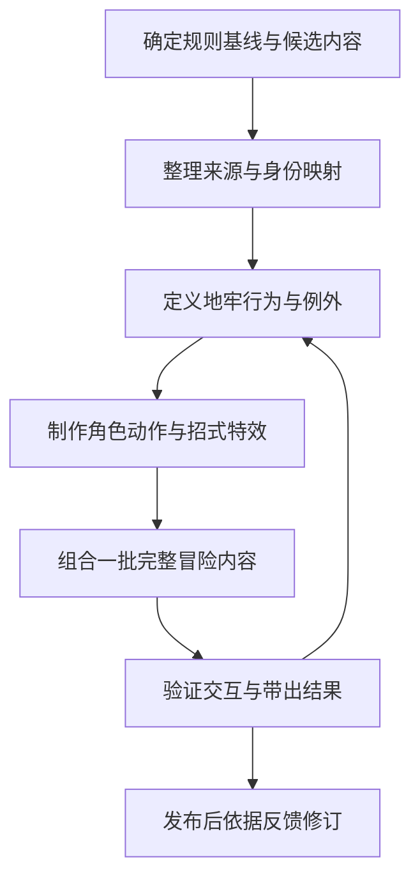

---
aliases:
  - 数据素材与内容制作总览
tags:
  - 主题/制作流程
  - 研究/建议
updated: 2026-10-25
---
# 数据素材与内容制作总览

本流程是研究建议，服务于 Showdown 资料、二维迷宫和有限阵容的既定方向。当前为初期框架构建，不制作游戏代码。行动推进回合与伙伴委托方向已给定；具体时代、阵容、行动顺序和融合机制仍待决定。[[项目目标与当前决策]]

流程的职责与阶段见[研究与制作运行方式](../项目框架/研究与制作运行方式.md)。已有来源先做可用性与适配检查，本作独有的招募、走失与付费回归另行形成规格；不重做已经可复用的基础资料。

当前批次范围以[分阶段范围与扩展顺序](../项目框架/分阶段范围与扩展顺序.md)为准：先形成普通探险、可用新人和基地招式培养，再扩连续区域。Z 晶、Mega 延后；资料已收录不表示同批适配。每个首批伙伴至少完成[入队状态与基础招式组合](../玩法研究/新伙伴入队状态与基地培养.md)，才能进入招募表。

## 制作顺序

数据与素材准备可以部分并行，但只有角色、行为、素材和遭遇配置都可用时，才能把某个成员算作可玩内容。

| 流程 | 主要交付物 | 详细入口 |
| --- | --- | --- |
| 数据整理 | 来源版本、身份映射、名单、差异与缺项 | [[制作流程/数据整理与招式适配流程]] |
| 招式适配 | 共用行为、参数覆盖、特殊行为和升级渠道 | [[pokebonk/招式适配与融合系统]] |
| 素材制作 | 动作与方向清单、特效、来源与转换记录 | [[制作流程/角色素材与招式特效流程]] |
| 新内容制作 | 一批相关角色、遭遇、道具与玩法交互 | [[制作流程/新内容制作与发布流程]] |
| 单项记录 | 依据、方案、缺项与验证状态 | [[制作流程/内容制作卡模板]] |

## 共用方法与适用边界

PokéBonk 证明公开客户端采用共用招式行为、逐招覆盖与配方流程；其等级和实时参数不宜直接成为我们的规则。竞技场项目提供用户偏好的视觉参考，内部制作工具仍不明确。

制作状态至少应能区分资料已收录、行为有方案、素材可用和完整内容已验证。这样可以先整理较广资料，再有选择地完成少量内容，不把导入数量当作完成数量。

依据：[[pokebonk/数据与素材组织]]、[[pokebonk/融合资格与强化继承]]、[[pokemon-arena-2d/视觉样式参考与素材规格]]。返回：[研究总索引](../README.md)。