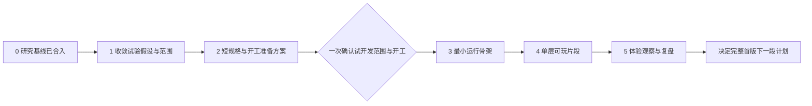

---
aliases:
  - 地牢项目里程碑
  - 从研究到试开发的计划
tags:
  - 项目/路线图
  - 项目/里程碑
updated: 2026-10-30
---
# 从研究到试开发的阶段路线图

**先收敛一份试验方案和可执行规格，再用一个小型可玩片段检验伙伴选择与操作负担，最后依据实际体验决定是否进入完整首版。** 不再按单个算例不断开启新一轮研究。

这是一份阶段路线图：阶段说明工作范围，里程碑说明阶段结束时应当交出什么。顺序和依赖现在确定；日期与工时尚无实作依据，不写成排期承诺。路线PR #3、准备包PR #4和阶段3—4单层片段PR #5均已合并（PR #5合并提交03e0c2b）；当前处于阶段5之前，状态见文末。

## 目标、起点与终点

用户目标是完成个人能承担、能展示能力且玩家愿意玩的救援队式肉鸽地牢。三人同行已定；其他内容数量是预算，不追求凑满物种或系统列表。发布经验仍只来自八款参考游戏，自有mod仅作素材、技能与系统参考。

PR #1—#3已合入。当前main基线为`06cf1c010af01728742d73444b67c5e884a8d7f5`，其文件树与已复核的PR #3头1555ec6一致。此前PR #2的[复审](https://github.com/392fyc/pokemon-game-research/pull/2#issuecomment-6472957606)确认返回路线、直接动作预检与完整性；路线的[复核与合并记录](../审核请求/2026-10-29-阶段路线图.md)另记来源。合并不等于玩法定稿或试玩通过。

本路线的终点是**试开发复盘**：交出一个能实际操作的有限片段，说明伙伴选择是否成立、操作是否容易理解、制作成本暴露了什么，再决定继续、简化或暂停。完整首版、公开试玩和正式发布另立下一段计划，不在此处默认启动。

## 阶段轴与里程碑

| 阶段 | 要解决的问题 | 主要交付物与负责人 | 结束时的里程碑 | 当前状态 |
| --- | --- | --- | --- | --- |
| 0 研究基线 | 规则、算例与来源是否足以作为共同起点 | 主会话：已合入PR、固定提交及当前规则入口 | PR #2复审通过，合并树与复审树一致；资料能追溯 | 已完成 |
| 1 试验假设与范围 | 第一段试开发究竟检验什么，哪些问题暂不回答 | 主会话整合；pokemon-dungeon-lab检查玩法依赖；REA-research-lab检查制作负担。交付一份试验范围与决定表 | 每个核心问题有可观察结果；临时参数、延后项与用户决定分开，无需先定完整经济 | 已完成（PR #4） |
| 2 短规格与开工准备方案 | 开发者能否不猜规则就开始制作 | pokemon-dungeon-lab整理可执行规格与验收输入；REA-research-lab列环境、数据和素材依赖；主会话合并为一个开工包 | 指定输入的行动、结果、保存和界面行为均可说明；仓库、同步清单、依赖与检查方式明确 | 已完成（PR #4） |
| 3 最小运行骨架 | 规则能否在所选载体中正确执行和保存 | 开工获准后，pokemon-dungeon-lab主做工程与规则；主会话整合并在本机核对；REA按具体问题辅助。交付可运行构建及代表用例结果 | 浏览器内真实场景可输入、按队列结算、显示结果；最小保存/恢复路径实测可用 | 已完成（PR #5，03e0c2b） |
| 4 单层可玩片段 | 玩家能否真正体验伙伴、邀请、深入与返回 | 同一游戏工程接入固定地图、邀请比较、结果说明和中断恢复；主会话安排完整体验核对 | 从进入到退出/失败、恢复和重开均可走完；能比较已声明的玩法选择 | 已完成（PR #5，03e0c2b） |
| 5 体验观察与复盘 | 值不值得扩大成完整首版，先改什么 | 主会话汇总实际操作与观察；两云分别解释玩法问题和制作成本。交付继续/简化/暂停建议及下一段预算 | 结论能追到具体行为与限制；决定下一阶段范围，不用增加系统掩盖当前问题 | 制作者自测完成（PR #12）；用户决定暂不请体验者，玩家结论未验证 |

阶段1和2作为一份完整的**试开发准备包**连续推进，阶段2中的玩法规格与技术准备可分工并行。阶段3依赖开工确认及必要环境条件；阶段4依赖可工作的执行和保存骨架。阶段5不能用纸面推演替代实际观察。

## 阶段1：把研究问题收敛成试验方案

只保留三个主问题：

1. **伙伴是否改变行动选择。** 同一威胁下，保留远攻、换新人或让健康前排承伤的理由是否能被玩家理解；不把多一个收集实例当成新增战术能力。
2. **队伍操作是否值得付出。** 默认跟随、切主控、一次伙伴干预和非法输入提示能否让玩家完成意图；记录实际返程、误触、重新安排和求助。
3. **探索的信息是否影响决定。** 在出口结束、看见新威胁后返回、继续取物之间，玩家能否说明自己的理由；熟悉地图后失去观察价值也必须记录。

已有[6/9/11轮地图](../玩法研究/可返回出口的探险对照.md)、[同功能与不同功能招募例](../玩法研究/招募奖励与服务点取舍.md)和[规则表](../玩法研究/当前规则表.md)足够作为规格输入。只补会阻止执行或解释结果的缺项，不再为了证明“有趣”无限添加账本。规则是否容易用、地图是否值得再玩、玩家是否在乎旧伙伴，交给阶段4—5。

| 事项 | 准备包建议怎样处理 | 最晚何时需要决定 |
| --- | --- | --- |
| 可返回出口 | 以当前可返回候选作为试验基准，保留真实占位和资源；不新增单向门 | 开工确认时纳入临时基准，不要求永久定稿 |
| 招募定位 | 接受可以是一份奖励；主要检验同行者与打法选择，不要求每次邀请都两难 | 同上 |
| 新人资源 | 暂用现有半额输入，准确显示逐招PP；60%留作必要时的敏感性对照 | 同上；最终比例在实际体验后讨论 |
| 免费整备 | 若试验需要重复出发，明确是恢复试验起点还是游戏内整备；不混入救援和长期经济 | 在短规格中列清，开工确认时采用 |
| 试验中全灭的结果 | 明确全灭后仍同行成员、此前已回营成员和物资的记录与归属，以及是否延续至下次试验。若采用试验重置，须说明终局记录怎样保留、怎样从独立初态重开，不把它写成游戏内复活；走失、全部归营或重置均不能由开发者临场默认 | 阶段1提出临时方案，阶段2写入失败与恢复规格；与其他临时基准一起在开工前集中确认，不留到阶段4决定 |
| 交换机、商店、救援费与等待 | 首个试验片段不启用，保留完整首版的未决项及已定框架 | 扩展到完整首版前决定，不阻挡当前可玩验证 |
| 成长、基地培养与长期依恋 | 先用明确配招的旧伙伴与新人比较；不宣称已经检验长期培养价值 | 试开发复盘决定是否接通跨局培养闭环 |
| 名单、房间、层数、行为数量 | 只取能覆盖上述问题的最小输入，不把既有预算变为硬性数量 | 随短规格说明用途，新增项必须对应缺失的观察 |

用户已定约束直接沿用；代理负责细化和给出推荐。以上临时基准会一起放进开工包，请用户一次确认，避免每项参数单独询问。计划获认可不自动等于这些临时基准或游戏实现已经获准。

## 阶段2：交出可以直接执行的准备包

不再维护第二套规则全文。用[当前规则表](../玩法研究/当前规则表.md)作唯一规则入口，短规格只补本次实现的范围、输入、界面及检查点。

| 准备包部分 | 必须说明的内容 | 足够进入开工确认的条件 |
| --- | --- | --- |
| 场景与规则对应 | 固定地图、已知信息、队列、逐招资源、敌方选择；每条代表路线对应哪些规则 | 实现者无需自行猜顺序、落点、交互或结果；未采用的条文明确排除 |
| 代表输入 | 一次伙伴配合、直接动作占位拒绝、倒下不堵路、实际邀请与替换、B在G原地撤离、终局与恢复 | 每项有初始状态、动作、预期结果；复用已审输入，只为新增行为补例 |
| 玩家界面与观察 | 主控与队列、草稿状态、技能目标、邀请对照、已知威胁、结果和最后保存点 | 玩家要作的决定有必要信息；操作计数与未来实际按键统计分开 |
| 保存边界 | 本片段含有哪些完整轮末、邀请、待转场与终局状态；失败与重试怎样提示 | 不依赖“关闭后总能恢复”的含糊承诺；没有实现的状态明确标缺 |
| 工程与版本 | 准备仓当前状态、规则与场景快照清单、代码职责、依赖锁定及必要网络来源 | 列明实际开工要检查和同步什么；旧环境记录不冒充当前运行通过 |
| 数据与素材 | 先用自制几何占位、人工录入的算例数据与稳定实例标识；来源和替换位置明确 | 首个试验不依赖完整素材导入、Showdown全量数据或自有mod代码移植 |
| 观察记录与结束条件 | 每个主问题要观察的行为、求助、错误及不能回答的问题 | 观察可以推翻设计建议；不预设玩家一定喜欢，也不设无依据的满意比例 |

沿用已选的Phaser + TypeScript路线、网页先验证的安排。既有选型版本是历史基准；实际安装前核对官方资料并锁定版本，不在本计划里声称已重新验证最新依赖。

在阶段2可以只读核对准备仓、已有工具与网络条件，形成同步和检查清单。**安装依赖、建立工程、同步开发用快照和运行代码在开工获准后执行。** 有明确缺口时列出最小处理办法，不扩成工具升级或全网开放。云端能读GitHub连接不等于命令行推送已验证；沿实际可用路径交付即可。

### 一次开工确认包含什么

统一呈现：试验目标、临时玩法基准、实现/延后范围、准备仓与允许改动范围、依赖及必要环境操作、验证方式、停止条件。获得这一包的授权后，包内正常实现、检查、修复和交付连续进行；不因每个函数、地图格或参数再次询问。新增关键玩法、网络权限、公开发布或超出范围的成本另行说明。

## 阶段3—4：先运行，再形成可玩片段

这里描述未来的制作顺序，本轮没有开始执行。

**阶段3先打通一条真实路径：**按清单同步准备仓并核对来源 → 锁定依赖和建立最小工程 → 显示固定格子、三个占位角色与主控 → 输入一轮、按队列结算并显示结果 → 保存一个完整状态并恢复它。规则数据与显示分开，方便将现有算例变成回归检查。记录实际运行入口、构建与存档版本，按所选存储方式核对恢复位置；不能只凭代码相同就认定读到了同一记录。单元检查只覆盖真实规则风险，浏览器场景和实际输入仍须另验。

**阶段4再连接完整片段：**入口遭遇 → 真实邀请与新旧比较 → 正常出口选择 → 新信息与继续/返回 → 结果及重开；同时覆盖倒下、全灭和中断恢复。先使用一张固定单层研究地图及必要的状态变体，避免随机生成掩盖问题。状态变体是为了复现倒下或邀请边界，不算新增关卡数量。界面列为可用的招式和操作必须按规格执行，不用空按钮冒充已覆盖的伙伴能力；试验重置与游戏内复活明确分开。

| 本次试开发包含 | 完整首版前仍需另做 |
| --- | --- |
| 三人行动队列、主控切换、一次伙伴干预、默认跟随与换位 | 更多敌人、复杂房间、随机生成与长局节奏 |
| 普攻与足以比较射程/保护/控制的有限行为，准确HP/PP | 全面属性、特性、进化、全量招式或复杂构筑 |
| 倒下不堵路、邀请比较、按规则替换与回营结果 | 自然招募率、长期名册与培养价值、连续滚动补给的平衡 |
| 同层返回、取得并撤离、明确终局和本片段完整处理点恢复 | 跨层入口、跨层保存与较长探险的运行验证 |
| 自制占位素材和最小人工场景数据、必要的结果说明 | 代表角色素材转换、真实数据导入、逐项来源/许可/署名、最终美术 |
| 私有浏览器构建与本机浏览器检查 | Electron封装、Windows原生安装与升级验收、公开发行 |

阶段3的最小保存不能被称为已完成整个存档系统；阶段4必须覆盖该片段实际存在的轮末、邀请与终局恢复。若仍有未做的保存边界，保留“未完成”，不将其包装成已可交给玩家的稳定片段。跨层和完整经济没有纳入时，分别保留为后续缺口。

参考八款游戏的[发布与维护经验](../REA辅助研究/八款参考游戏—发布与维护经验—2026-10-27.md)，试开发就提供可辨认的构建版本、加载失败提示和保存状态，便于定位问题。现阶段不需要账号、排行榜、云存档或自动更新服务。将来接入第三方素材或数据前再完成对应固定版本、来源、许可和署名核对；不能以占位试验通过代替这一步。

## 阶段5：用实际行为决定下一段工作

先由制作者走完代表流程，排除会阻止观察的功能错误，再安排愿意参加的少量体验者。邀请他人需要用户提供参与方式或授权联系；未获得参与者时，可以完成自测和试验方案，但对玩家理解与喜爱的结论标为未验证。

记录是否熟悉救援队/地牢、第一次操作和熟悉后的差别。给目标，观察其选择，再询问理由；把研究者提示、求助、重试、直接输入、确认、切主控与伙伴安排分别记录。样本只用于发现问题，不估计市场份额或泛化为“多数玩家喜欢”。

| 观察问题 | 有用的证据 | 对下一段计划的影响 |
| --- | --- | --- |
| 伙伴选择是否有意义 | 玩家能把选择联系到具体射程、生命、位置或资源；哪些决定只为收集 | 保留有实际作用的差异；只有收集收益时不声称已有战术取舍 |
| 跟随与输入是否可理解 | 意图能否完成、非法输入能否解释、反复切人或改草稿发生在哪里 | 优先改规则表达、输入和地图；不先添加复杂战术菜单 |
| 返回是否值得保留 | 什么时候因新信息返回、多少行走没有新决定、熟悉后怎样选择 | 调整信息和地图连接；不先用额外费用或关门强制深入 |
| 中断与恢复是否可信 | 真实关闭/恢复、邀请与结算是否重复、失败提示能否理解 | 状态或数据错误先修；不能用新增内容抵消恢复问题 |
| 个人制作负担是否可承受 | 增加一个行为或改一处地图涉及多少实际工作、哪些适配重复 | 据实际成本决定下一批内容及是否先做一个真实素材样本 |

阶段结果允许三种：**继续**，保留有效核心，编制完整首版下一段计划；**简化后再测**，只修改导致障碍的部分并用相同任务复核；**暂停扩大**，核心选择仍不成立或成本不可承担，重新讨论目标和范围。连续两轮针对同一障碍修正仍无进展时，停止堆内容，重新判断问题。没有独立体验者时不强行给出玩家验证通过。

## 推进节奏、职责与研究停止条件

- 主会话维护本路线、当前决定、正式文档与PR；实现与独立验收各由一个清楚的执行者承担，不再开一层调度或同时改共享规则。
- 2026-10-29前，pokemon-dungeon-lab与REA-research-lab两个Codex云分别负责游戏工程与独立核查。2026-10-30起由本机Claude主会话接手：实现交给`mercury-dev`子代理，独立验收交给只读的`mercury-acceptance`与`mercury-reviewer`，两个Codex云改为用户手动派发的可选通道；详见[Claude作业方式](../工作环境/Claude作业方式.md)。执行者名称不代表任何功能已运行通过。
- 研究只为当前里程碑补真实缺口。存在可执行定义和必要反例后，转向实作或观察；未来内容进入延后清单，不拖住本段。
- 以“准备包”“可运行骨架”“可玩片段与复盘”组织交付。每阶段可以有正常提交，但不把每条规则或参数单独拆PR、审批或审查轮次。
- 阶段1—2在既有研究授权内自主推进；阶段3开始前集中确认开工包。获得范围授权后连续完成阶段3—4；阶段5依据实际证据汇总，再请用户判断是否扩大制作。合并PR、联系参与者、公开发布等仍按各自实际授权执行。
- 每次有实质变化才更新阶段状态，说明交付物、未解决问题、影响范围和下一步。若新证据推翻假设，改受影响阶段及其后续依赖，不悄悄更换验收目标。

## 当前交付与下一关口

阶段3—4已完成：单层伙伴地牢片段以[PR #5](https://github.com/392fyc/pokemon-dungeon-lab/pull/5)合并（合并提交03e0c2b），在Windows Edge上实际通过规则、保存与浏览器检查，并经两轮独立审核（[审核](https://github.com/392fyc/pokemon-dungeon-lab/pull/5#issuecomment-6485884528)与[复审](https://github.com/392fyc/pokemon-dungeon-lab/pull/5#issuecomment-6486457456)）；证据与限制见[实现验收记录](../trial-acceptance-2026-10-29.md)。研究库于2026-10-29并入本仓`docs/`；2026-10-30在Windows本机对并入后的main 40090c3重跑实现自测34项、独立断言75项与生产构建，全部通过，主脚本SHA-256与复审版本相同。

下一关口是阶段5：先由制作者走完代表流程，排除会妨碍观察的功能错误，再安排独立体验者。邀请体验者需要用户提供参与方式或授权联系；在此之前，玩家理解与喜爱的结论保持未验证。

2026-10-30完成第一步的[制作者自测](阶段5制作者自测-2026-10-30.md)：所走的代表流程与规格一致；发现的换位草稿错误和直线拒绝原因已修复，其余可读性问题记入[观察记录表](../玩法研究/阶段5观察记录表.md)留待体验者验证。

用户随后决定暂不请独立体验者，并授权自主推进完整首版的下一段：见[阶段6：完整首版的最小循环](阶段6—完整首版最小循环计划.md)。进入阶段6依据的是用户决定，不是玩家证据；上述玩家问题随阶段6继续保留为未验证假设。

阶段1—2的历史交付：[试开发准备包](试开发准备包.md)32931fe经审核通过并合并。

阶段1—2的来源与两云分工见[分工记录](../市场研究/研究范围与双云分工.md)，检查范围见[准备包审核入口](../审核请求/2026-10-29-试开发准备包.md)。已只读核对准备仓远端／本地与游戏云实际HEAD、工具和策略；不同来源的状态分别记录，不能互相代替。截至准备包审核时，依赖下载、工程运行、浏览器保存、第三方许可和玩家体验仍未验证。路线原交付依据保留在[路线图审核记录](../审核请求/2026-10-29-阶段路线图.md)。

完整首版与连续区域的远期内容见[范围与扩展顺序](分阶段范围与扩展顺序.md)；它说明以后可能做什么，本页决定从现在怎样推进到试开发，二者不构成并列的开工清单。当前数量预算见[核心玩法](../玩法研究/核心玩法与首版范围.md)，试验候选见[首片段方案](../玩法研究/返程与招募的首片段方案.md)。
